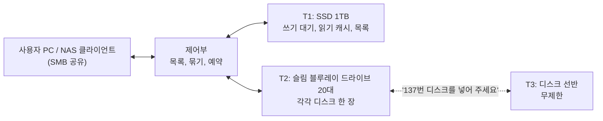

# 32TB 교차점 (The 32 TB Crossover)

<p align="center">
  <strong>2026년 저장장치 가격 위기 속 HDD 콜드 스토리지를 대체하는 로봇 없는 개인용 블루레이 계층형 아카이브</strong><br>
  <em>OSH 이론 (Optical Shelf Hierarchy, 광디스크 선반 계층), 창안: <a href="https://axnli.com">AXNli Inc.</a></em>
</p>

<p align="center">
  <a href="./README.md"></a>
  <a href="./README.ko.md"></a>
  <a href="https://axnli.com"></a>
  <a href="./LICENSE"></a>
</p>

> 🇺🇸 **English version: [README.md](./README.md)**

**상태:** 포지션 페이퍼와 비용 모델 (이론 단계). 아래 모든 숫자는 [`model/crossover.py`](./model/crossover.py)로 다시 계산할 수 있고, 실제 시제품으로 검증할 수 있습니다. 시제품은 아직 만들지 않았습니다.

**버전:** 1.0, 2026-11-24


## 초록

2026년, AI 데이터센터 수요 때문에 HDD와 SSD 가격이 크게 올랐고, 제조사들은 올해 HDD 생산 물량이 대부분 팔렸다고 밝혔습니다. 수십 TB의 **콜드 데이터**(옛 촬영 원본, 사진 보관함, 끝난 프로젝트)를 쌓아 두는 개인과 소규모 작업실은 사상 최고가에 디스크를 더 사거나, 지우거나 둘 중 하나를 골라야 합니다. 이 논문은 이들에게 **로봇 없는 블루레이 장치 + SSD 앞단**이 저장소의 콜드 계층을 대체하는 합리적인 선택이라고 주장합니다.

장치는 디스크를 한 장씩 꽂은 슬림 블루레이 드라이브 20대, 모든 쓰기와 자주 읽는 파일을 받아 주는 SSD 1TB, 그리고 필요할 때 사용자가 넣어 주는 무제한의 **선반 디스크**로 이루어집니다. 장치값은 한 번만 내고 용량이 늘면 디스크값만 늘기 때문에, 2026-11-24 한국 소매가 기준으로 **약 32TB**(장치 원가에 따라 31.6TB~37.3TB)에서 대용량 HDD 한 개보다 싸지는 **교차점**이 생깁니다. 교차점 위로는 격차가 계속 벌어집니다. 100TB에서 장치는 약 459만 원, HDD는 약 759만 원이고, 500TB에서는 약 1,739만 원 대 약 3,794만 원입니다. 교차점 아래에서는 비용 이점이 없으며 권장하지 않습니다.

광디스크 라이브러리와 계층형 저장의 결합은 새로운 생각이 아닙니다. Facebook(2014), ROS(EuroSys 2017), 소니 Everspan이 로봇과 PB급 랙으로 데이터센터용 시스템을 만들었습니다. 이 논문의 기여는 이 생각을 2026년 가격에서 **개인 규모로 끌어내린 것**입니다. 로봇 없음, 시중 부품, 사람이 관리하는 선반, 명시적인 교차점 공식, 5V 전원 설계, 그리고 이 생각이 통하지 않는 지점에 대한 정직한 정리입니다.


## 1. 동기

### 1.1 2026년 저장장치 가격 위기

* 2026년 2월, 웨스턴디지털은 2026년 HDD 생산 물량 대부분이 이미 배정되었다고 밝혔습니다 [7].
* Tech4Gamers가 인용한 DigiTimes 보도에 따르면 2026년 2분기 HDD 공급 부족이 더 심해졌고 거래 가격이 전 분기보다 10% 올랐습니다 [6].
* 분석가들은 2025년에 시작된 저장장치 가격 상승이 2026년 내내 이어질 것으로 보았습니다 [8].

2026-11-24 필자가 확인한 국내 최저가(네이버 가격비교):

| 제품 | 용량 | 최저가 (원) | GB당 (원) |
| :--- | ---: | ---: | ---: |
| 삼성 9100 PRO M.2 NVMe | 8TB | 3,975,000 | 496.9 |
| 삼성 870 QVO SATA | 8TB | 3,456,500 | 432.1 |
| 삼성 870 EVO SATA | 8TB | 4,720,000 | 590.0 |
| 삼성 870 EVO SATA | 1TB | 386,442 | 386.4 |
| 씨게이트 SkyHawk AI 7200RPM | 32TB | 2,428,000 | 75.9 |
| 50GB BD-R (DL) 50장 [9] | 2.5TB | 약 80,000 | **32.0** |

### 1.2 같은 문제를 실제로 겪는 사용자

구독자 7.68만 명의 국내 IT 유튜버 JN테크리뷰는 2026년 11월 영상에서 바로 이 상황을 다뤘습니다 [9]. 영상 촬영본을 담은 NAS가 30TB 가까이 찼고, 대용량 HDD가 너무 비싸서, 5만 원짜리 외장 드라이브로 옛 촬영본을 50GB 블루레이에 직접 굽기 시작했습니다. 그가 말한 수작업의 불편함은 이렇습니다.

1. 한 번 구우면 남은 공간은 버려진다 (50GB 디스크에 37.1GB만 구워 GB당 32원이 약 43원으로 올라감).
2. 6배속 드라이브로 한 장에 약 30분. 16배속 드라이브는 이제 드물고 비싸다.
3. 드라이브 소음이 크다.
4. 재기록 BD-RE는 GB당 가격이 HDD와 비슷해서 쓸 이유가 없다.
5. 퇴근 전에 하루 한 장씩 굽는다 (하루 약 30GB).

장점으로는 GB당 최저 가격, 랜섬웨어와 온라인 공격으로부터의 물리적 분리, 무기 기록층(HTL) 디스크의 긴 수명, 프로젝트마다 디스크 한 장으로 정리하는 만족감을 꼽았습니다.

위 불편함은 전부 **디스크의 문제가 아니라 작업 방식의 문제**입니다. 이 논문은 바로 그 빈틈을 다룹니다.


## 2. 기존 연구: 이미 알려진 것

| 시스템 | 연도 | 규모 | 기계 장치 | 계층화 | 발표된 결과 |
| :--- | :--- | :--- | :--- | :--- | :--- |
| Facebook 블루레이 콜드 스토리지 [1][2] | 2014 | 랙당 1PB, 디스크 10,000장 | 로봇 팔, 12장 카트리지 | 데이터센터 | 기존 HDD 콜드 스토리지 대비 비용 50%, 에너지 80% 절감 |
| ROS, 화중과기대 [3] | 2017 | PB급, 42U 랙, 디스크 수천 장 | 회전 롤러와 로봇 팔 | **SSD + HDD + 광디스크**, FUSE 파일 시스템(OLFS) | 광디스크 데이터를 일반 폴더(POSIX)처럼 접근 |
| 소니 Everspan [4] | 2016 | 시스템당 최대 181PB | 로봇, 8레이저 드라이브 | 데이터센터 객체 저장소 | 미디어 100년 보증 |
| 광학 주크박스 + HSM [13] | 1990년대부터 | TB~PB | 로봇 피커 | 안 쓰는 파일을 디스크에서 광디스크로 이동 | 표준 아카이브 방식 |
| DiscHub Workgroup 주크박스 [16] | | 소규모 사무실 | 로봇 | 드라이브 문자로 보임 | **단종** |

두 가지 결론이 나옵니다.

1. **광디스크 + SSD/HDD 앞단은 이미 증명된 구조입니다.** 특히 ROS [3]는 SSD, 하드디스크, 광디스크를 결합해 기계 지연을 숨겼습니다. 이 논문은 이 생각을 자기 것이라고 주장하지 않습니다.
2. **증명된 시스템은 모두 데이터센터용이고 로봇을 씁니다.** 개인용 상용 제품은 사라졌습니다. 1.2장의 사용자 같은 개인과 소규모 작업실 규모는 비어 있습니다.


## 3. 주장

> **약 32TB를 넘는 콜드 데이터에서는, 로봇 없이 슬림 블루레이 드라이브 20대, SSD 1TB 앞단, 사용자가 관리하는 디스크 선반으로 만든 장치가 하드디스크를 사는 것보다 싸다. 그리고 용량이 늘수록 디스크값만 늘기 때문에 비용 이점은 끝없이 커진다.**

이것은 개인 저장소의 **콜드 계층**을 대체한다는 주장이지, 매일 쓰는 작업 저장소를 대체한다는 주장이 아닙니다. 매일 바뀌는 데이터에는 여전히 HDD와 SSD가 맞습니다.


## 4. 구조

### 4.1 3계층

| 계층 | 담당 | 첫 바이트까지 시간 | 용량 |
| :--- | :--- | :--- | :--- |
| **T1** SSD (1TB) | 자주 쓰는 파일, 굽기 대기 파일, 전체 목록과 썸네일 | 즉시 | 1TB |
| **T2** 드라이브 20대에 꽂힌 디스크 20장 | 최근 보관 디스크 | 2~5초 (회전 시작) | 50GB × 20 = 1TB |
| **T3** 선반 | 나머지 모든 디스크 | 요청하면 사람이 넣음 | **무제한** (100장, 10,000장, 100,000장) |



T3가 이 생각의 핵심입니다. 선반에 있는 디스크의 파일을 열면 장치가 **"000137번 디스크를 넣어 주세요"**라고 답합니다. 전체 목록이 SSD에 있기 때문에 폴더 탐색에는 디스크가 필요 없습니다.

### 4.2 왜 로봇이 없나

| | A. 드라이브 20대 (이 논문) | B. 드라이브 1~2대 체인저 |
| :--- | :--- | :--- |
| 드라이브값 | 5만 원 × 20 = 100만 원 | 5만~10만 원 |
| 기계 장치 | 없음 | 회전 트레이, 리프트, 센서, 모터 |
| 개발 위험 | 낮음 (전원, 배선, 소프트웨어) | 높음 (걸림, 오정렬, 긁힘) |
| 첫 접근 (장치 안 디스크) | 2~5초 | 15~30초 |
| 32TB(640장) 6배속 굽기 | **약 16.5시간** (20대 동시) | 약 329시간 (한 장씩) |
| 고장 | 한 대 고장 나도 19대 동작 | 기계 고장 시 전체 멈춤 |
| 굽는 중 전력 | 최대 약 126W | 약 6W |

로봇은 드라이브 수를 줄이려고 존재합니다. 개인 규모에서는 슬림 드라이브가 약 5만 원이라, 믿을 만한 기계 장치를 설계하고 고장을 잡는 것보다 드라이브 20대가 더 싸고, 굽기도 20배 빠릅니다. 20장을 넘는 디스크는 사람이 로봇입니다. 디스크 한 장 넣는 데 몇 초면 되고, 콜드 데이터라 그런 일이 드뭅니다.

### 4.3 SSD 앞단이 하는 일 세 가지

1. **쓰기 대기실.** 파일은 즉시 SSD에 저장됩니다. 디스크 한 장 분량의 약 95%가 모였을 때만 굽습니다. 1.2장의 공간 낭비 문제가 사라지고 실제 비용이 GB당 32원 근처로 유지됩니다.
2. **읽기 캐시.** 한 번 읽은 파일은 SSD에 남습니다 (오래 안 읽은 순서로 비움, 보관 완료된 파일만).
3. **목록.** 파일 이름, 크기, 해시, 디스크 번호, 썸네일. 그래서 아카이브가 일반 폴더처럼 보입니다.

### 4.4 데이터 흐름

**쓰기:** 클라이언트 → SSD (사용자 입장에서는 끝) → 묶기 프로그램이 디스크 크기에 맞게 파일을 묶음 → 예약 시간(밤)에 굽기 → **다시 읽어 해시 비교로 검증** → 보관 완료 표시 → 그 뒤에만 SSD 사본을 비울 수 있음.

**읽기:** SSD에 있으면 즉시 → 없고 T2에 있으면 2~5초 뒤 읽기 → 없으면 사용자에게 디스크 번호 요청 → 꺼내면서 SSD에 복사.

**안전 규칙:** 굽기와 검증이 끝나기 전까지 파일은 SSD에만 있습니다. 장치는 검증 전에 원본을 지워도 된다고 절대 말하면 안 됩니다. 중요한 폴더는 두 장에 구워 다른 장소에 보관할 수 있습니다.

### 4.5 디스크 선택

| | BD-R | BD-RE |
| :--- | :--- | :--- |
| 쓰기 속도 | 최대 16배속 | 2배속 |
| 가격 | 가장 쌈 | GB당 HDD와 비슷 [9] |
| 장기 보관 | 유리 | 상대적으로 불리 |
| 랜섬웨어, 실수 삭제 | 지울 수 없음 | 지워질 수 있음 |

다시 써야 하는 일은 SSD 계층이 모두 맡기 때문에 **BD-R(가능하면 무기 기록층 HTL)**이 기본입니다. M-DISC는 주인보다 오래 남아야 할 데이터를 위한 선택 등급입니다.


## 5. 비용 모델과 교차점

### 5.1 공식

*F*를 SSD 계층을 포함한 장치 고정비, *h*를 HDD의 GB당 가격, *b*를 디스크의 GB당 가격, *f*를 디스크 평균 채움 비율이라고 하면

```
교차점_GB = F / ( h  -  b / f )
```

교차점 아래에서는 HDD가 싸고, 위에서는 장치가 쌉니다. 절약액은 용량에 비례해 GB당 (h − b/f)씩 늘어납니다.

### 5.2 입력값 (2026-11-24, 원)

* *b* = 80,000 / 50장 / 50GB = **GB당 32.0원** [9]
* *h* = 2,428,000 / 32,000GB = **GB당 75.9원** (SkyHawk AI 32TB)
* SSD 계층 = 386,442원 (870 EVO 1TB)
* 경우 S1: 장치 하드웨어 100만 원 (필자 추정), *F* = 1,386,442
* 경우 S2: 드라이브 20대 × 5만 원 + 전원, 허브, 제어부, 케이스 25만 원, *F* = 1,636,442

### 5.3 결과 (단위: 만 원)

**S1 (F = 138.6)**

| 용량 | 디스크 | 블루레이 장치 | HDD | SSD |
| ---: | ---: | ---: | ---: | ---: |
| 1TB | 20 | 141.8 | 7.6 | 49.7 |
| 10TB | 200 | 170.6 | 75.9 | 496.9 |
| **32TB** | 640 | **241.0** | **242.8** | 1,590.0 |
| 100TB | 2,000 | 458.6 | 758.8 | 4,968.8 |
| 500TB | 10,000 | 1,738.6 | 3,793.8 | 24,843.8 |
| 1,000TB | 20,000 | 3,338.6 | 7,587.5 | 49,687.5 |

**S2 (F = 163.6):** 32TB 266.0, 100TB 483.6, 500TB 1,763.6, 1,000TB 3,363.6.

### 5.4 교차점

| 경우 | 교차점 |
| :--- | ---: |
| S1, 디스크 꽉 채움 | **31.6TB** |
| S2, 디스크 꽉 채움 | **37.3TB** |
| S1, HDD GB당 90원 ([9]의 가격) | 23.9TB |
| S1, 디스크 74%만 채움 ([9]처럼 50GB에 37.1GB) | 42.3TB |
| S2, 디스크 74%만 채움 | 50.0TB |

마지막 두 줄이 쓰기 대기실(4.3장)이 단순한 편의 기능이 아니라 이 설계의 **경제적 핵심**인 이유를 보여 줍니다. 없으면 교차점이 10~13TB 뒤로 밀립니다.

### 5.5 HDD 칸이 숨기는 것

HDD 숫자는 **백업 없는 32TB 디스크 한 개**입니다. 한 번 고장 나면 32TB 전체가 위험합니다. 사본까지 포함해 공정하게 비교하면 HDD 칸은 두 배가 되지만, 장치는 중요한 폴더만 골라 두 번째 디스크를 구우면 됩니다. 블루레이 디스크 한 장이 망가지면 잃는 것은 32TB가 아니라 50GB입니다. 또 사용자는 큰 디스크를 미리 사는 대신 필요할 때 필요한 만큼만 디스크를 삽니다.


## 6. 전원과 에너지

### 6.1 전력 예산

슬림 외장 블루레이 드라이브는 USB 5V로 동작합니다 [10]. 슬림 6배속 드라이브 한 대의 실측값은 **6.3W**였습니다 [11].

| | 값 |
| :--- | ---: |
| 드라이브 1대 굽는 중 | 약 6.3W (5V 약 1.3A) |
| 드라이브 20대 굽는 중 | 약 126W (5V 약 25A) |
| 권장 전원 | **5V 40A (200W)**, 약 60% 여유 |

### 6.2 2026년에 만드는 두 가지 방법

1. **완제품:** 5V 40A 민웰 전원이 내장된 20포트 산업용 USB 3.0 허브는 20개 포트 모두에 동시에 최대 2.1A를 공급하고 온도 제어 팬도 있습니다 [12]. 일부 제품은 10포트씩 두 개의 업스트림 케이블로 나뉘어 대역폭 문제도 해결합니다 (7장).
2. **직접 제작:** **Mean Well LRS-200-5** 하나 (5V 40A, 팬 없는 자연 냉각, 215 × 115 × 30mm, 약 30달러) [14], 드라이브마다 **퓨즈 또는 eFuse를 하나씩** 단 배전 기판 (드라이브 하나가 단락돼도 나머지 19대는 동작), 데이터만 담당하는 USB 허브 보드.

펌웨어는 돌입 전류를 피하기 위해 **순차 기동**(1~2초 간격으로 한 대씩)을 해야 합니다.

### 6.3 에너지 모델 (계산값, 실측 예정)

* 굽기: 6.3W × 50GB 디스크 한 장당 0.51시간(6배속) ≈ **기록 1TB당 65Wh** (드라이브만).
* 보관: 선반 위 디스크는 **0W**. T3 용량이 늘어도 전기요금은 늘지 않습니다.
* Facebook은 데이터센터 버전에서 기존 HDD 콜드 스토리지 대비 에너지 80% 절감을 발표했습니다 [2].

제어부, SSD, 회전을 멈춘 드라이브의 대기 전력은 아직 측정하지 않았으며 향후 과제입니다.


## 7. 데이터 대역폭

* 20대가 6배속으로 동시에 구우면 약 20 × 27MB/s ≈ **540MB/s**가 필요합니다.
* USB 3.0 한 줄은 실제 약 400MB/s 정도라, 허브의 업스트림 두 줄을 서로 다른 USB 컨트롤러에 연결하거나, 예약 프로그램이 동시 굽기 대수를 제한합니다 (예: 10대씩).
* 읽기는 보통 한두 장씩이라 병목이 아닙니다.
* 전체 동시 굽기 중 SSD는 약 540MB/s 읽기를 유지해야 합니다. NVMe는 여유, SATA는 경계선입니다.


## 8. 한계와 정직한 반론

| 반론 | 답 |
| :--- | :--- |
| **약 32TB 아래에서는 오히려 손해다.** | 맞습니다. 교차점 아래에서는 권장하지 않습니다. |
| "HDD와 SSD를 대체한다." | 콜드 계층만입니다. 작업 데이터는 HDD나 SSD에 둡니다. |
| "10만 장, 100만 장." | 물리적으로는 가능하지만, 디스크를 찾아 넣는 사람의 시간과 보관 공간, 라벨 관리가 필요합니다. 용량은 무제한이지만 편의는 무제한이 아닙니다. |
| 디스크 공급 | 소니는 2025년 2월 기록용 블루레이 생산을 끝냈습니다 [5]. Verbatim 등은 계속 판매합니다. 여러 브랜드와 25, 50, 100GB 디스크를 모두 지원해야 합니다. |
| 드라이브 공급 | 16배속은 드뭅니다 [9]. 6배속을 기준으로 설계하고, 20대에 마모를 나누고 예비 드라이브를 둡니다. |
| HDD 가격이 정상화되면 | 교차점이 올라갑니다. 5.1장 공식으로 누구나 다시 계산할 수 있습니다. 가격 외 장점(오프라인, 랜섬웨어 차단, 보관 시 0W)은 남습니다. |
| 디스크 가격이 오르면 | 마찬가지로 현재 *b*로 다시 계산합니다. |
| 데이터 신뢰 | 다시 읽어 검증, 디스크마다 오류 정정 데이터, 검증 전 삭제 금지, 선택적 이중 굽기. |
| 소음과 열 | 굽기는 예약 시간에. 케이스에 공기 흐름과 방진 설계. |
| 드라이브 수명 | 드라이브당 수백 장 굽기 수명은 미확인. 측정 예정. |


## 9. 증명하거나 반증하는 방법

이 주장은 반증 가능합니다. 시제품은 다음을 보여야 합니다.

1. **비용:** 실제 가격의 부품 목록을 `model/crossover.py`에 넣었을 때 예측 범위 근처의 교차점이 나온다.
2. **채움 비율:** 쓰기 대기실로 디스크 평균 95% 이상 채움.
3. **처리량:** 드라이브 20대로 640장(32TB)을 24시간 안에 굽고 검증.
4. **전력:** 전체 동시 굽기 중 최대 150W 미만, 대기 전력 실측.
5. **무결성:** 구운 모든 디스크를 해시로 검증. 일부러 긁은 디스크를 오류 정정 데이터로 복구.
6. **사용성:** 선반 방식("N번 디스크를 넣어 주세요")으로 1분 안에 읽기 완료.

측정한 교차점이 32TB보다 훨씬 높거나 채움 비율을 높게 유지할 수 없다면, 그 가격 수준에서 이 주장은 실패합니다.


## 10. 구현 메모

* **시제품 설계:** 실제 시중 부품(슬림 블루레이 드라이브, 라즈베리파이 5 또는 미니 PC, NVMe 베이스, 민웰 전원)의 치수와 전력 사양을 기준으로 3D 배치와 배선을 먼저 모델링할 예정입니다.
* **소프트웨어 부품 (사용 전 라이선스 재확인):** 굽기와 검증용 `xorriso`, 오류 정정 데이터용 `dvdisaster`, 여러 계층을 하나의 폴더로 보여 주는 참고용 `mergerfs`, 표준 체인저 제어용 `mtx`.
* **향후 체인저 버전 참고:** 오픈소스 라즈베리파이 디스크 로더 JacktheRipperBot.


## 11. 결론

2026년에 블루레이가 싸진 것이 아닙니다. 하드디스크와 SSD가 비싸졌습니다. 거의 건드리지 않는 데이터를 수십 TB씩 가진 사람에게, 이 변화는 광디스크 아카이브의 손익분기점을 약 32TB까지 끌어내렸습니다. 데이터센터는 이미 광디스크 앞에 SSD 계층을 두는 방식이 통한다는 것을 보여 줬습니다. 빠져 있던 것은 로봇 없이, 누구나 살 수 있는 부품으로, 랙 대신 선반으로 만든 버전입니다. 대단한 발명은 아닙니다. 익숙한 디스크를 다르게 바라본 생각이고, 누구나 확인할 수 있는 숫자와 함께 제시합니다.


## 참고문헌

영문판 [README.md](./README.md#references)의 참고문헌 1~16과 같습니다.

1. Data Center Knowledge, Facebook 1PB 블루레이 랙, 2014-01-30.
2. Slashdot / Computerworld, Facebook 블루레이 저전력 저장 시스템 (비용 50%, 에너지 80% 절감), 2014-01-29.
3. W. Yan 외, "ROS: A Rack-based Optical Storage System with Inline Accessibility for Long-Term Data Preservation," EuroSys 2017; ACM Transactions on Storage 2018, doi:10.1145/3231599.
4. DatacenterDynamics, 소니 Everspan.
5. Tom's Hardware, 소니 기록용 블루레이 미디어 생산 종료.
6. Tech4Gamers, 2026년 2분기 HDD 공급 부족 심화와 가격 10% 상승.
7. Notebookcheck, 웨스턴디지털 2026년 HDD 물량 배정, 2026-02-16.
8. CIO 코리아, 스토리지 부족과 기업 AI 전략, 2026.
9. JN테크리뷰, "가성비 저장소로 다시 떠오르는 블루레이 디스크, 직접 서버 백업용으로 사용해봤습니다," YouTube, 2026-11. https://www.youtube.com/watch?v=lzo9U7xPKSE
10. ASUS 외장 슬림 블루레이 데이터시트 (USB +5V).
11. OWC, 슬림 블루레이 6배속 전력 소비 6.3W.
12. Newegg, 5V 40A 민웰 전원 내장 20포트 USB 3.0 허브 (포트당 2.1A).
13. Wikipedia, "Optical jukebox".
14. Protosupplies, Jameco, Mean Well LRS-200-5.
15. Microsoft Research, Project Silica (유리 아카이브 저장), SOSP 2023.
16. Kintronics, DiscHub Workgroup 주크박스 (단종).

1.1장의 소매가는 2026-11-24 필자가 네이버 가격비교에서 확인한 최저가이며 바뀔 수 있습니다.


## 인용

```bibtex
@misc{axnli2026osh,
  title  = {The 32 TB Crossover: A Robot-Free Blu-ray Archive with SSD Tiering as a Personal Alternative to HDD Cold Storage in the 2026 Storage Price Crisis},
  author = {AXNli Inc.},
  year   = {2026},
  note   = {OSH Theory (Optical Shelf Hierarchy)},
  url    = {https://github.com/kokogo100/OSH-Architecture}
}
```

* **창안:** [AXNli Inc. (주식회사 에이엑스엔엘아이)](https://axnli.com)
* **분석과 작성 도움:** Claude (Anthropic)
* **라이선스:** MIT License (© 2026 AXNli Inc.)
