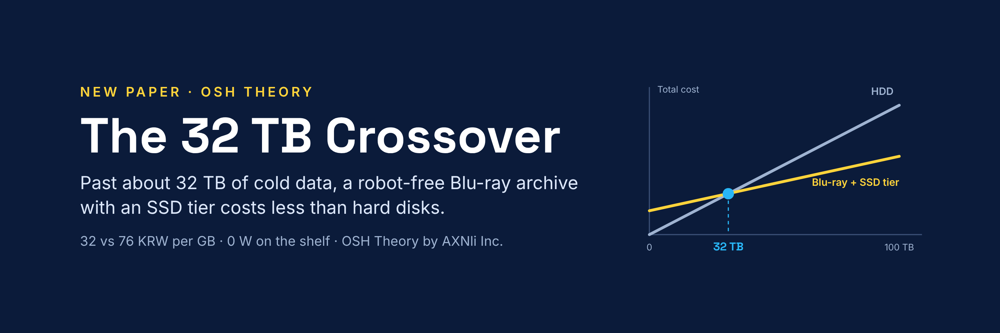
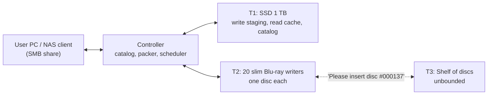

# The 32 TB Crossover

<p align="center"></p>

<p align="center">
  <strong>A Robot-Free Blu-ray Archive with SSD Tiering as a Personal Alternative to HDD Cold Storage in the 2026 Storage Price Crisis</strong><br>
  <em>OSH Theory (Optical Shelf Hierarchy), originated by <a href="https://axnli.com">AXNli Inc.</a></em>
</p>

<p align="center">
  <a href="./README.md"></a>
  <a href="./README.ko.md"></a>
  <a href="https://axnli.com"></a>
  <a href="./LICENSE"></a>
</p>

> 🇰🇷 **The Korean version of this paper is in [README.ko.md](./README.ko.md).**

**Status:** position paper and cost model (theory). Every number below can be reproduced with [`model/crossover.py`](./model/crossover.py) and checked against a physical prototype. No prototype has been built yet.

**Version:** 1.0, 2026-11-24


## Abstract

In 2026, demand from AI data centers has pushed hard disk and SSD prices up sharply, and manufacturers report their HDD capacity for the year as largely sold out. Individuals and small studios that accumulate tens of terabytes of *cold data* (old video footage, photo archives, finished projects) face a hard choice: pay record prices for more disks, or delete. We argue that for this group a **robot-free Blu-ray appliance with an SSD front tier** is a rational replacement for the cold tier of their storage.

The appliance has twenty slim Blu-ray writers that each hold one disc, a 1 TB SSD that absorbs all writes and hot reads, and an unbounded **shelf** of further discs that the user inserts when asked. Because the appliance is paid for once and only the media grows with capacity, total cost falls below a single high-capacity HDD at a **crossover of about 32 TB** (31.6 TB to 37.3 TB depending on build cost), using retail prices observed in Korea on 2026-11-24. Above the crossover the gap widens: at 100 TB the appliance costs about 4.6 million KRW against 7.6 million KRW for HDDs, and at 500 TB about 17.4 million KRW against 37.9 million KRW. Below the crossover the appliance has no cost advantage and we do not recommend it.

The idea of optical libraries with tiered storage is not new: Facebook (2014), the ROS system (EuroSys 2017) and Sony Everspan built them for data centers with robots and petabyte racks. Our contribution is to move the idea **down** to personal scale under 2026 prices: no robot, off-the-shelf parts, a human-in-the-loop shelf, an explicit crossover formula, a 5 V power design, and an honest account of where the idea fails.


## 1. Motivation

### 1.1 The 2026 storage price crisis

* In February 2026 Western Digital reported that most of its HDD production capacity for 2026 was already allocated [7].
* A DigiTimes report cited by Tech4Gamers states that the HDD supply shortage worsened in Q2 2026, with trade prices up 10% quarter over quarter [6].
* Analysts expected the storage price increases that began in 2025 to continue throughout 2026 [8].

On 2026-11-24, the lowest Korean retail prices (Naver Shopping) observed by the author were:

| Product | Capacity | Lowest price (KRW) | Per GB (KRW) |
| :--- | ---: | ---: | ---: |
| Samsung 9100 PRO M.2 NVMe | 8 TB | 3,975,000 | 496.9 |
| Samsung 870 QVO SATA | 8 TB | 3,456,500 | 432.1 |
| Samsung 870 EVO SATA | 8 TB | 4,720,000 | 590.0 |
| Samsung 870 EVO SATA | 1 TB | 386,442 | 386.4 |
| Seagate SkyHawk AI 7200 RPM | 32 TB | 2,428,000 | 75.9 |
| 50 GB BD-R (DL), 50 discs [9] | 2.5 TB | about 80,000 | **32.0** |

### 1.2 A real user with the problem

A Korean tech YouTuber (JN Tech Review, 76,800 subscribers) published a video in November 2026 describing exactly this situation [9]: his NAS of video footage was close to 30 TB, large HDDs were too expensive, so he started burning old footage to 50 GB Blu-ray discs by hand with a 50,000 KRW external drive. He reported the pain points of the manual method:

1. Space left on a disc is wasted once it is burned (37.1 GB on a 50 GB disc raised his cost from 32 to about 43 KRW per GB).
2. A 6x drive needs about 30 minutes per disc; 16x drives are now rare and expensive.
3. The drive is loud.
4. Rewritable BD-RE media costs about as much as HDD, so it is not worth it.
5. He burns one disc per day before leaving the office (about 30 GB per day).

He also listed the benefits: the cheapest cost per GB, physical isolation from ransomware and online attacks, long media life for inorganic (HTL) discs, and the satisfaction of one disc per project.

Every pain point above is a *workflow* problem, not a *media* problem. That is the gap this paper addresses.


## 2. Prior Work: What Is Already Known

| System | Year | Scale | Mechanism | Tiering | Reported result |
| :--- | :--- | :--- | :--- | :--- | :--- |
| Facebook Blu-ray cold storage [1][2] | 2014 | 1 PB per rack, 10,000 discs | Robot arm, cartridges of 12 discs | Data center | 50% lower cost, 80% lower energy than its HDD cold storage |
| ROS, Huazhong Univ. of Sci. and Tech. [3] | 2017 | PB level, 42U rack, thousands of discs | Rotatable roller and robot arm | **SSD + HDD + optical**, FUSE file system (OLFS) | Inline (POSIX) access to optical data |
| Sony Everspan [4] | 2016 | Up to 181 PB per system | Robot, 8-laser drives | Data center object storage | 100-year media warranty |
| Optical jukeboxes with HSM [13] | 1990s onward | TB to PB | Robotic pickers | Migrate unused files from disk to optical | Standard archival practice |
| DiscHub Workgroup jukebox [16] | | Small office | Robot | Appeared as a drive letter | **Discontinued** |

Two conclusions follow.

1. **Optical media plus an SSD/HDD front tier is a proven architecture.** ROS [3] in particular already combines SSDs, hard disks and optical discs to hide mechanical delay. We do not claim this idea.
2. **All proven systems target data centers and use robots.** Commercial products for individuals have disappeared. The personal and small-studio scale, exactly the scale of the user in Section 1.2, is unserved.


## 3. Thesis

> **For cold data above roughly 32 TB, a robot-free appliance of twenty slim Blu-ray writers, a 1 TB SSD front tier, and a user-managed shelf of discs is cheaper than buying hard disks, and its cost advantage grows without limit as capacity grows, because only the media scales.**

We claim this as a replacement for the **cold tier** of personal storage, not for active working storage. HDDs and SSDs remain the right choice for data that changes every day.


## 4. Architecture

### 4.1 Three tiers

| Tier | Holds | Time to first byte | Capacity |
| :--- | :--- | :--- | :--- |
| **T1** SSD (1 TB) | Hot files, files waiting to be burned, full catalog and thumbnails | Immediate | 1 TB |
| **T2** Twenty discs in twenty drives | Recently archived discs | 2 to 5 s (spin-up) | 20 x 50 GB = 1 TB |
| **T3** Shelf | Every other disc | Human inserts the disc when asked | **Unbounded** (100, 10,000, 100,000 discs) |



T3 is the core of the idea. When a user opens a file whose disc is on the shelf, the appliance answers **"Please insert disc #000137"**. Because the full catalog lives on the SSD, browsing folders never needs a disc.

### 4.2 Why robot-free

| | A. Twenty drives (this paper) | B. Changer with 1 or 2 drives |
| :--- | :--- | :--- |
| Drive cost | 20 x 50,000 KRW = 1,000,000 KRW | 50,000 to 100,000 KRW |
| Mechanics | None | Carousel, lift, sensors, motors |
| Development risk | Low (power, wiring, software) | High (jams, misalignment, scratches) |
| First access (disc inside) | 2 to 5 s | 15 to 30 s |
| Burning 32 TB (640 discs) at 6x | **about 16.5 h** (20 in parallel) | about 329 h (one at a time) |
| Failure mode | One drive fails, 19 keep working | Mechanism fails, everything stops |
| Power while writing | up to about 126 W | about 6 W |

A robot exists to reduce the number of drives. At personal scale a slim drive costs about 50,000 KRW, so twenty drives are cheaper than designing and debugging a reliable mechanism, and they write twenty times faster. Beyond twenty discs the human is the robot: inserting a disc takes seconds and happens rarely for cold data.

### 4.3 The SSD front tier does three jobs

1. **Write staging.** Files land on the SSD immediately. A disc is burned only when about 95% of a disc worth of data has accumulated. This removes the wasted-space problem of Section 1.2 and keeps the real cost near 32 KRW per GB.
2. **Read cache.** Files read once stay on the SSD (least recently used eviction, archived files only).
3. **Catalog.** File name, size, hash, disc number and thumbnails, so the archive behaves like an ordinary folder.

### 4.4 Data path

**Write:** client to SSD (done, from the user's point of view) → packer groups files into disc-sized sets → scheduler burns at a set time (night) → **verify by reading back and comparing hashes** → mark as archived → only then the SSD copy may be evicted.

**Read:** SSD hit returns immediately → else the disc is in T2: read in 2 to 5 s → else ask the user for the disc number → copy into the SSD on the way out.

**Safety rule:** until a file is burned and verified it exists only on the SSD. The appliance must never tell the user that originals may be deleted before verification. Important folders can be burned to two discs for off-site storage.

### 4.5 Media choice

| | BD-R | BD-RE |
| :--- | :--- | :--- |
| Write speed | up to 16x | 2x |
| Price | lowest | close to HDD per GB [9] |
| Long-term archive | better | weaker |
| Ransomware or accidental deletion | impossible to erase | erasable |

The SSD tier takes over everything that needs rewriting, so **BD-R (preferably HTL, inorganic recording layer)** is the default. M-DISC is an optional class for data meant to outlive its owner.


## 5. Cost Model and the Crossover

### 5.1 Formula

Let *F* be the fixed cost of the appliance including the SSD tier, *h* the HDD price per GB, *b* the media price per GB, and *f* the average fill ratio of a disc. Then

```
crossover_GB = F / ( h  -  b / f )
```

Below the crossover an HDD is cheaper; above it the appliance is cheaper, and the saving grows linearly with capacity at (h − b/f) per GB.

### 5.2 Inputs (2026-11-24, KRW)

* *b* = 80,000 / 50 discs / 50 GB = **32.0 KRW per GB** [9]
* *h* = 2,428,000 / 32,000 GB = **75.9 KRW per GB** (SkyHawk AI 32 TB)
* SSD tier = 386,442 KRW (870 EVO 1 TB)
* Scenario S1: appliance hardware 1,000,000 KRW (author's estimate), so *F* = 1,386,442
* Scenario S2: twenty drives at 50,000 KRW plus 250,000 KRW for power, hub, controller and case, so *F* = 1,636,442

### 5.3 Results (units of 10,000 KRW)

**S1 (F = 138.6)**

| Capacity | Discs | Blu-ray appliance | HDD | SSD |
| ---: | ---: | ---: | ---: | ---: |
| 1 TB | 20 | 141.8 | 7.6 | 49.7 |
| 10 TB | 200 | 170.6 | 75.9 | 496.9 |
| **32 TB** | 640 | **241.0** | **242.8** | 1,590.0 |
| 100 TB | 2,000 | 458.6 | 758.8 | 4,968.8 |
| 500 TB | 10,000 | 1,738.6 | 3,793.8 | 24,843.8 |
| 1,000 TB | 20,000 | 3,338.6 | 7,587.5 | 49,687.5 |

**S2 (F = 163.6):** 32 TB 266.0, 100 TB 483.6, 500 TB 1,763.6, 1,000 TB 3,363.6.

### 5.4 Crossover points

| Case | Crossover |
| :--- | ---: |
| S1, full discs | **31.6 TB** |
| S2, full discs | **37.3 TB** |
| S1, HDD at 90 KRW/GB (price quoted in [9]) | 23.9 TB |
| S1, discs only 74% full (37.1 of 50 GB, as in [9]) | 42.3 TB |
| S2, discs only 74% full | 50.0 TB |

The last two rows show why write staging (Section 4.3) is not a convenience but the **economic core** of the design: without it the crossover moves out by 10 to 13 TB.

### 5.5 What the HDD column hides

The HDD figure is one 32 TB disk **with no copy**. A single failure endangers all 32 TB. A fair comparison with a second copy doubles the HDD column, while the appliance can burn a second disc only for the folders that matter. A failed Blu-ray disc loses 50 GB, not 32 TB. The user also buys media only when needed, instead of buying a large disk up front.


## 6. Power and Energy

### 6.1 Power budget

Slim external Blu-ray writers run on USB 5 V [10]. One slim 6x writer was measured at **6.3 W** [11].

| | Value |
| :--- | ---: |
| One drive writing | about 6.3 W (5 V, about 1.3 A) |
| Twenty drives writing | about 126 W (5 V, about 25 A) |
| Recommended supply | **5 V 40 A (200 W)**, about 60% headroom |

### 6.2 Two ways to build it in 2026

1. **Off the shelf:** 20-port industrial USB 3.0 hubs with a built-in 5 V 40 A Mean Well supply deliver up to 2.1 A on all twenty ports at once and include a temperature-controlled fan [12]. Some route ten ports to each of two upstream cables, which also solves bandwidth (Section 7).
2. **Built:** one **Mean Well LRS-200-5** (5 V 40 A, fanless, convection cooled, 215 x 115 x 30 mm, about 30 USD) [14], a power distribution board with **one fuse or eFuse per drive** so that a single shorted drive cannot take down the other nineteen, and a USB hub board that carries data only.

Firmware must **stagger spin-up** (one drive every 1 to 2 s) to avoid inrush current.

### 6.3 Energy model (computed, to be measured)

* Writing: 6.3 W x 0.51 h per 50 GB disc at 6x ≈ **65 Wh per TB written** (drive only).
* At rest: a disc on the shelf draws **0 W**. Capacity in T3 grows without growing the power bill.
* Facebook reported 80% lower energy than its HDD cold storage for its data-center version [2].

Idle power of the controller, the SSD and spun-down drives has not been measured and is listed as future work.


## 7. Data Bandwidth

* Twenty drives writing at 6x need about 20 x 27 MB/s ≈ **540 MB/s**.
* One USB 3.0 link delivers roughly 400 MB/s in practice, so the hub's two upstream links should go to two separate USB controllers, or the scheduler limits concurrent burns (for example 10 at a time).
* Reads are normally one or two discs at a time and are not a bottleneck.
* The SSD must sustain about 540 MB/s of reads during a full parallel burn: NVMe is comfortable, SATA is borderline.


## 8. Limits and Honest Objections

| Objection | Answer |
| :--- | :--- |
| **Below about 32 TB it is worse.** | Correct. The appliance is not recommended below the crossover. |
| "It replaces HDDs and SSDs." | Only the cold tier. Active data stays on HDD or SSD. |
| "100,000 or 1,000,000 discs." | Physically possible, but finding and inserting a disc takes human time, and storage space and labeling matter. Capacity is unbounded; convenience is not. |
| Media supply | Sony ended recordable Blu-ray production in February 2025 [5]. Verbatim and others still sell media. The design must support several brands and 25, 50 and 100 GB media. |
| Drive supply | 16x drives are rare [9]. The design assumes 6x and spreads wear over twenty drives with spares. |
| HDD prices may normalize | Then the crossover moves up. The formula in 5.1 lets anyone recompute it. Non-price benefits (offline, ransomware-proof, 0 W at rest) remain. |
| Media price may rise | Same: recompute with current *b*. |
| Data trust | Read-back verification, error-correction data on each disc, no deletion before verification, optional double burn. |
| Noise and heat | Burns are scheduled; the enclosure needs airflow and damping. |
| Drive lifetime | Unknown for hundreds of burns per drive; to be measured. |


## 9. How to Prove or Disprove This

The thesis is falsifiable. A prototype must show:

1. **Cost:** a bill of materials with real prices, inserted into `model/crossover.py`, gives a crossover near the predicted range.
2. **Fill ratio:** average disc fill of at least 95% with write staging.
3. **Throughput:** 640 discs (32 TB) burned and verified in under 24 hours with twenty drives.
4. **Power:** peak below 150 W during a full parallel burn; measured idle power.
5. **Integrity:** every burned disc verified by hash; recovery from a deliberately scratched disc using error-correction data.
6. **Usability:** the shelf workflow ("insert disc #N") completes a read in under one minute.

If the measured crossover is far above 32 TB, or the fill ratio cannot be kept high, the thesis fails at that price level.


## 10. Implementation Notes

* **Prototype design:** the appliance will first be modeled in 3D with real off-the-shelf part dimensions and power specs (slim Blu-ray writers, Raspberry Pi 5 or a mini PC, NVMe base, Mean Well supply) before physical assembly.
* **Software building blocks (licenses to be re-checked before use):** `xorriso` for burning and verification, `dvdisaster` for error-correction data, `mergerfs` as a reference for presenting tiers as one folder, `mtx` for standard changers.
* **Reference for a future changer variant:** JacktheRipperBot, an open-source Raspberry Pi disc loader.


## 11. Conclusion

Blu-ray did not become cheaper in 2026; hard disks and SSDs became expensive. For people who keep tens of terabytes of data they rarely touch, that shift moves the break-even point of optical archiving down to about 32 TB. Data centers have already shown that optical media behind an SSD tier works. What was missing is a version without a robot, built from parts anyone can buy, with a shelf instead of a rack. This is not a grand invention. It is a different way of looking at a familiar medium, with numbers that anyone can check.


## References

1. Data Center Knowledge, "Blu-Ray in the Data Center? Facebook Creates 1 Petabyte Storage Rack," 2014-01-30. https://www.datacenterknowledge.com/servers/blu-ray-in-the-data-center-facebook-creates-1-petabyte-storage-rack
2. Slashdot / Computerworld, "Facebook Puts 10,000 Blu-ray Discs In Low-Power Storage System," 2014-01-29. https://hardware.slashdot.org/story/14/01/29/1510246/facebook-puts-10000-blu-ray-discs-in-low-power-storage-system
3. W. Yan, J. Yao, Q. Cao, C. Xie et al., "ROS: A Rack-based Optical Storage System with Inline Accessibility for Long-Term Data Preservation," EuroSys 2017, pp. 161 to 174; extended in ACM Transactions on Storage, 2018, doi:10.1145/3231599. https://ranger.uta.edu/~jiang/publication/Conferences/2017/2017-EUROSYS-ROS-%20A%20Rack-based%20Optical%20Storage%20System%20with%20Inline%20Accessibility%20for%20Long-Term%20Data%20Preservation.pdf
4. DatacenterDynamics, "Optical disc as the future of data archiving" (Sony Everspan). https://www.datacenterdynamics.com/en/analysis/optical-disc-as-the-future-of-data-archiving/
5. Tom's Hardware, "After 18 years, Sony's recordable Blu-ray media production draws to a close." https://www.tomshardware.com/pc-components/storage/after-18-years-blu-ray-media-production-draws-to-a-close-sony-shuts-its-last-factory-in-feb
6. Tech4Gamers, "Hard Drive Supply Shortages Get Even Worse, With Prices Rising 10% in Q2 2026." https://www.tech4gamers.com/hard-drive-supply-shortages-get-even-worse/
7. Notebookcheck, "RAM shortage spreads: HDDs may soon be in short supply," 2026-02-16. https://www.notebookcheck.net/RAM-shortage-spreads-HDDs-may-soon-be-in-short-supply.1227566.0.html
8. CIO Korea, storage shortage and enterprise AI strategy, 2026. https://www.cio.com/article/4122536
9. JN Tech Review (JN테크리뷰), "가성비 저장소로 다시 떠오르는 블루레이 디스크, 직접 서버 백업용으로 사용해봤습니다," YouTube, 2026-11. https://www.youtube.com/watch?v=lzo9U7xPKSE
10. ASUS external slim Blu-ray writer datasheet (USB power +5 V). https://www.farnell.com/datasheets/2148769.pdf
11. OWC, "Slim BluRay 6x USB 2 Power Draw." https://eshop.macsales.com/Service/Knowledgebase/Article/15/539/OWC-Slim-BluRay-6x-USB-2-Power-Draw
12. Newegg, 20-port USB 3.0 hub with built-in 5 V 40 A Mean Well supply, 2.1 A per port. https://www.newegg.com/p/0Y3-0686-002S8
13. Wikipedia, "Optical jukebox." https://en.wikipedia.org/wiki/Optical_jukebox
14. Protosupplies, "Mean Well LRS-200-5"; Jameco price listing. https://protosupplies.com/?p=3371 , https://www.jameco.com/z/LRS-200-5-MEAN-WELL-200W-5V-40A-Single-Output-Switchable-Power-Supply_2219719.html
15. Microsoft Research, "Project Silica" (glass archival storage), SOSP 2023. https://www.microsoft.com/en-us/research/uploads/prod/2023/09/ProjectSilica-SOSP23.pdf
16. Kintronics, DiscHub Workgroup jukebox (discontinued). https://kintronics.com/?p=8208

Retail prices in Section 1.1 are lowest prices on Naver Shopping observed by the author on 2026-11-24 and will change.


## Citation

```bibtex
@misc{axnli2026osh,
  title  = {The 32 TB Crossover: A Robot-Free Blu-ray Archive with SSD Tiering as a Personal Alternative to HDD Cold Storage in the 2026 Storage Price Crisis},
  author = {AXNli Inc.},
  year   = {2026},
  note   = {OSH Theory (Optical Shelf Hierarchy)},
  url    = {https://github.com/kokogo100/OSH-Architecture}
}
```

* **Originated by:** [AXNli Inc. (주식회사 에이엑스엔엘아이)](https://axnli.com)
* **Analysis and drafting assisted by:** Claude (Anthropic)
* **License:** MIT License (© 2026 AXNli Inc.)
